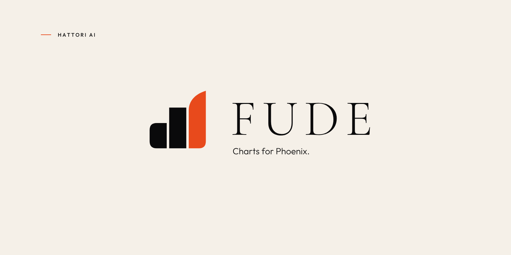
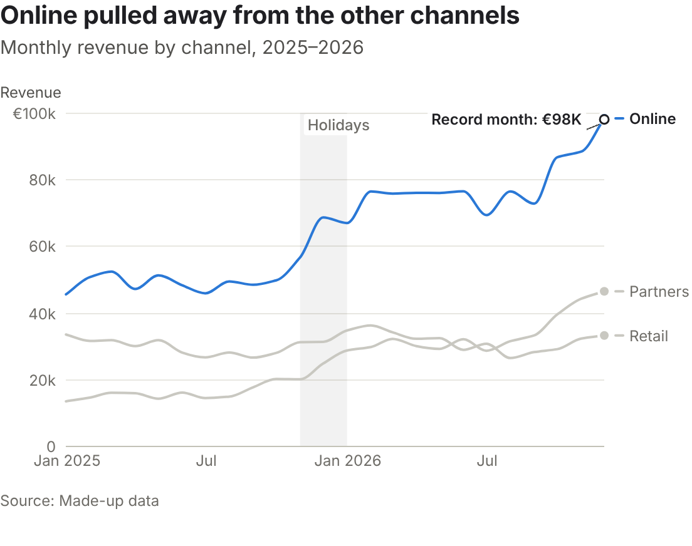
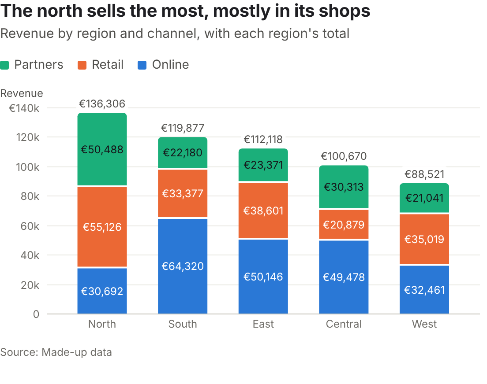
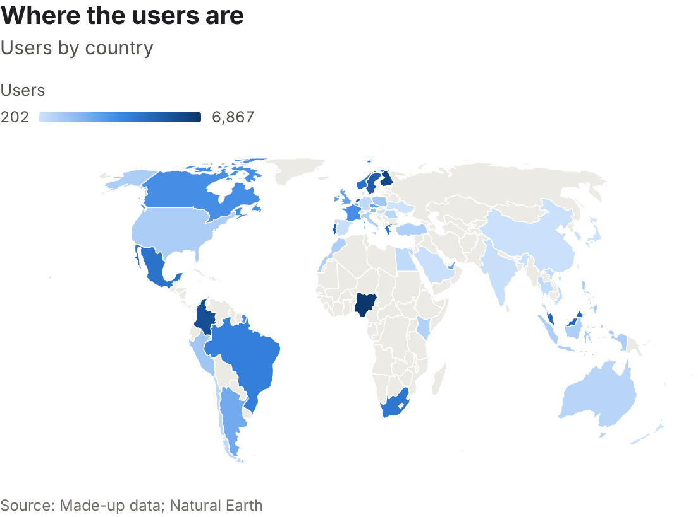
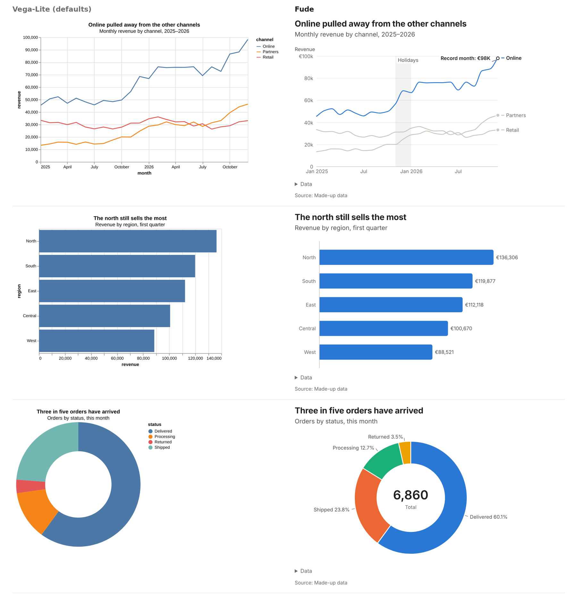

# Fude



[](https://hex.pm/packages/fude)
[](https://hexdocs.pm/fude)
[](https://github.com/hattoriai/fude/actions)

Fude (筆, “brush”) is a charting library for Phoenix LiveView. Give it
Elixir data and describe what goes on each axis; Fude draws the chart and
updates it when your data changes.

It's for Phoenix developers building dashboards, reports, and other places
where data needs to be understood at a glance. Start with a bar or line
chart, then add things like annotations, multiple series, maps, or live
updates as the story calls for them.



Fude includes bar, line, area, scatter, pie, donut, histogram, heatmap,
waterfall, funnel and map charts, as well as sparklines and single-value
indicators. Charts have tooltips, keyboard navigation, screen reader
descriptions and a data table. They can be themed, exported, and composed
in layers or small multiples.

<table>
<tr>
<td></td>
<td></td>
</tr>
</table>

Charts are set as a graphics desk sets them, by default: a title that
reads first, the data labelled where the labels fit (and the legend left
out where they name every series), the unit on the top tick only, and
notes placed off the data. The same charts with Vega-Lite's defaults and
with Fude's (the line chart adds a highlight and two notes, both options;
the bars and the donut are as they come):



`mix dev` serves these at <http://localhost:4099/newsroom>: each kind as
a newsroom would publish it.

## Quickstart

Fude requires Elixir 1.18+, Phoenix 1.7.14 or 1.8, and LiveView 1.1+.
Add it to your dependencies in `mix.exs`:

```elixir
{:fude, "~> 0.8"}
```

Install the dependency and set up the LiveView hook and stylesheet:

```sh
mix deps.get
mix fude.install
```

The installer prints its changes and any manual steps your app needs. Use
`mix fude.install --dry-run` to preview them. The JavaScript bundle comes
with the package; you don't need Node.js to build Fude itself.

Import the components in the `html_helpers` function of your app's web
module, usually `lib/my_app_web.ex`:

```elixir
import Fude.Components
```

Then use a chart in a LiveView:

```elixir
defmodule MyAppWeb.SalesLive do
  use MyAppWeb, :live_view

  def mount(_params, _session, socket) do
    sales = [
      %{region: "North", revenue: 120},
      %{region: "South", revenue: 85},
      %{region: "West", revenue: 150}
    ]

    {:ok, assign(socket, sales: sales)}
  end

  def render(assigns) do
    ~H"""
    <.chart
      id="revenue"
      chart={Fude.bar(@sales, x: :region, y: :revenue, title: "Revenue by region")}
    />
    """
  end
end
```

Replace the sample list with your own data. When the `@sales` assign
changes, the chart updates in place. See the [Quickstart guide](guides/quickstart.md)
for a longer walkthrough and manual installation.

## Go further

**Shape the story.** Channels can aggregate values or group dates, and
charts can carry titles, sources and annotations:

```elixir
Fude.line(orders, x: {:month, :placed_on}, y: {:sum, :total}, color: :channel)
|> Fude.title("Online keeps growing", subtitle: "Monthly revenue by channel")
```

**Use your data.** Fude accepts lists of maps and query results. With
Ecto 3.13+, it can also group and aggregate a query in the database:

```elixir
Order
|> Fude.query(Repo)
|> Fude.bar(x: :status, y: {:count, :id}, title: "Orders by status")
```

**Keep charts around.** `Fude.Spec.dump/1` turns a chart into a
versioned map; `Fude.Spec.load/1` loads it again. You can also stream
new rows, export charts to SVG or PNG in the browser, or export their
words and data as Markdown, text or HTML on the server.

## Documentation

- [Quickstart](guides/quickstart.md) — setup and your first chart
- [Charts](guides/charts.md) — chart types, channels, layers and options
- [Data](guides/data.md) — lists, query results and Ecto queries
- [Telling the story](guides/story.md) — titles, annotations and small multiples
- [Maps](guides/maps.md) — world and US maps
- [Live](guides/live.md) — updates, streaming and browser export
- [Specs](guides/specs.md) — save and load chart definitions
- [Theming](guides/theming.md) and [accessibility](guides/accessibility.md)
- [Testing](guides/testing.md) and [collaboration with Issho](guides/collaboration.md)
- [Known limits](guides/limits.md)
- [API reference on HexDocs](https://hexdocs.pm/fude)

## Development and contributing

To run the chart gallery locally:

```sh
mix deps.get
mix fude.build
mix dev
```

Open <http://localhost:4099>. Run `mix test` for the Elixir tests and
`mix test.js` for the JavaScript tests. See [CONTRIBUTING.md](https://github.com/hattoriai/fude/blob/main/CONTRIBUTING.md)
for the development and pull request guidelines.

## License

Fude is available under the [MIT License](https://github.com/hattoriai/fude/blob/main/LICENSE). The maps include
public-domain data and other open-source material; see [NOTICE](https://github.com/hattoriai/fude/blob/main/NOTICE).
